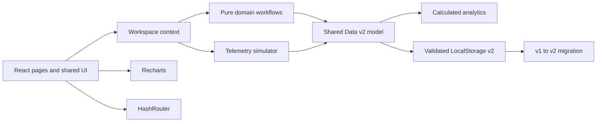
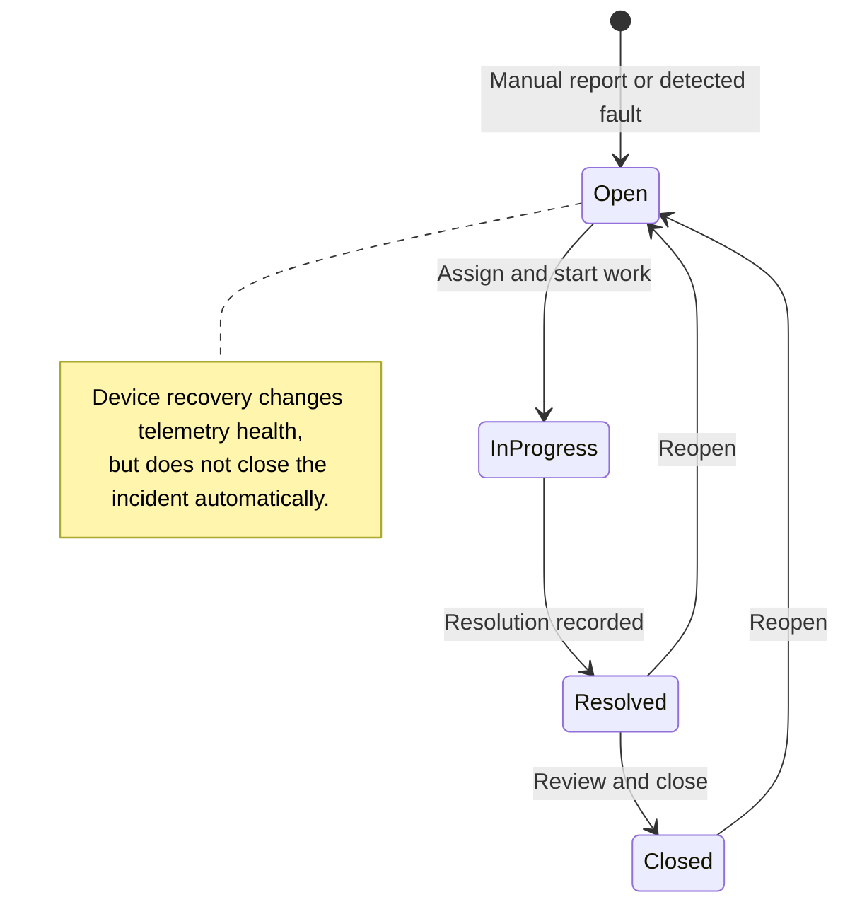

# HubOps

## Project Overview

HubOps is an independent student project for managing the fictional infrastructure, equipment, technical incidents, maintenance, HSE observations, people, and operational reporting of a technology park. It is a browser-based demonstration: all identities, addresses, devices, and operational records are fictional.

## Problem Statement

Facility and engineering teams often track locations, physical assets, faults, service work, and safety actions in separate tools. HubOps demonstrates how those records can share one consistent data model and one workflow: a simulated device fault changes equipment health, creates an incident, notifies the operator, and updates dashboard and analytics calculations immediately.

## Key Features

- Asset inventory with 10 equipment categories, CRUD, search, filters, sorting, cards/table views, real QR links, CSV export, ownership, locations, fault history, and linked records.
- explicitly labelled **Simulated Hardware Monitoring** with category-aware telemetry, bounded history, configurable frequency, eight fault/recovery scenarios, automatic detection, and interval cleanup.
- Incident management with manual and monitoring sources, four priorities, four workflow states, assignment, comments, history, overdue highlighting, Kanban and table views, closing, and reopening.
- Maintenance calendar, recurring schedules, six inspection templates, checklists, reminders, history, and asset inspection-date updates.
- Demonstration HSE hazard register, inspections, corrective actions, deadlines, building/risk filters, and a 5×5 risk matrix.
- Calculated analytics for equipment, incidents, maintenance, HSE, tasks, and employee workload, with CSV and print output.
- Existing facility and team/task workflows, global cross-module search, notification center, activity log, light/dark appearance, responsive navigation, and accessible dialogs.
- Versioned LocalStorage schema, v1→v2 migration, deep JSON backup validation, import/export, and referential-integrity checks.

## Live Demo

GitHub Pages deployment is configured for:

`https://tooleksandr-0101.github.io/HubOps/`

The workflow has not been claimed as deployed or publicly verified in this branch. Until a successful `main` deployment is confirmed, run the project locally.

## Screenshots

Static screenshots are intentionally not committed yet. The interface changes with the local simulated telemetry state; use the local app or the verified Pages deployment to see the current implementation. This avoids presenting stale or fabricated product images.

## Architecture



The application uses one immutable aggregate data model. Pages read it through `useWorkspace()` and submit transformations through `update()`. The store persists validated snapshots, adds meaningful activity records, and owns the single telemetry interval. Routine telemetry samples do not flood the activity log.

### Incident lifecycle



See [Architecture](docs/ARCHITECTURE.md) and [Hardware Integration](docs/HARDWARE_INTEGRATION.md).

## Technology Stack

- React 19 and strict TypeScript
- Vite 8 and Tailwind CSS 4
- React Router `HashRouter`
- Recharts
- Lucide icons
- Radix Slot and a local shadcn-style Button
- QRCode React
- Vitest, React Testing Library, jsdom, ESLint, and V8 coverage
- GitHub Actions and GitHub Pages

## Hardware Simulation

No real equipment is connected. The simulation service produces only metrics that apply to a device category: online state, heartbeat, latency, temperature, battery, uptime, connection state, and health. It supports camera offline, payment terminal failure, connection loss, overheating, electronic lock failure, refrigerator temperature violation, low battery, and device recovery.

New monitoring faults create one active incident per asset/fault pair, update equipment condition, add a notification and activity entry, and flow into analytics. Telemetry is capped globally and per asset to protect browser storage. Recovery restores readings but deliberately leaves incident closure to the operator.

## Quality Assurance

Verified locally on 2026-11-24:

- `npm ci` — passed with the committed lockfile.
- `npm run typecheck` — passed.
- `npm run lint` — passed with zero warnings.
- `npm test` — 15/15 Vitest tests passed across 3 files, including browser-like Assets and Incidents form workflows in jsdom.
- `npm run test:coverage` — passed; overall coverage is documented in [Validation](docs/VALIDATION.md).
- `npm run build` — passed with route-level code splitting and no large-chunk warning.

Automated tests cover schema validation, persistence, v1 migration, fault detection, incident deduplication, recovery, telemetry limits, relationship-safe deletion, incident workflow behavior, maintenance completion, asset validation, and analytics semantics. The complete browser demo flow remains a documented manual test because Playwright browser binaries are not installed in this project.

See [Test Plan](docs/TEST_PLAN.md), [Test Cases](docs/TEST_CASES.md), and [Requirements](docs/REQUIREMENTS.md).

## Getting Started

Requirements: Node.js 22.12 or a newer supported LTS, and npm.

```sh
git clone https://github.com/TOOleksandr-0101/HubOps.git
cd HubOps
npm ci
npm run dev
```

Open the URL printed by Vite. Useful checks:

```sh
npm run typecheck
npm run lint
npm test
npm run test:coverage
npm run build
npm run preview
```

Use Settings to export a JSON backup before clearing browser storage or resetting demo data.

## Deployment

The production build uses Vite base path `/HubOps/` and `HashRouter`, which are compatible with project GitHub Pages. The workflow validates every change and deploys only a successful `main` build.

Repository owner action required once:

1. Open **Settings → Pages** in GitHub.
2. Set **Source** to **GitHub Actions**.
3. Merge the reviewed engineering branch into `main`.
4. Confirm that the `Deploy GitHub Pages` job succeeds.
5. Verify the URL shown above before publishing it as a live demo.

## Limitations

- Frontend-only; there is no backend, authentication, authorization, RBAC, multi-user sync, or server audit log.
- LocalStorage is device-specific and is not a security boundary. Do not store sensitive data.
- Monitoring is simulated; HubOps does not communicate with real hardware.
- The HSE module is not certified and does not replace professional inspections or legal compliance processes.
- Historical uptime is `N/A` until actual simulated online samples exist; current availability is reported separately.
- Browser end-to-end automation is not installed; the critical scenario is covered by a documented manual test.

## Roadmap

- Backend API with authentication and server-enforced authorization.
- PostgreSQL for operational records and a time-series database for telemetry.
- MQTT, SNMP, REST, WebSocket, and IoT gateway adapters behind a validated ingestion service.
- Server-side notifications, attachments, multi-user collaboration, and immutable audit storage.
- Playwright coverage for the complete camera-offline-to-incident-closure scenario.
- Verified public Pages deployment and current project screenshots.

## Development Team

- **Medina ([medeyyn](https://github.com/medeyyn))** — Foundation, frontend architecture, UI/UX, facility management, and team & tasks.
- **Alexandr ([TOOleksandr-0101](https://github.com/TOOleksandr-0101))** — Engineering modules, hardware simulation, incident management, maintenance, HSE, analytics, QA, and deployment configuration.

MIT licensed. Prepared with AI assistance; contributors should review and understand changes before presenting them.
