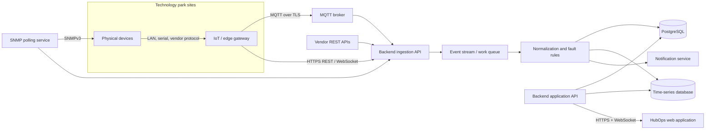

# Hardware Integration Architecture

## Current implementation

HubOps currently implements **Simulated Hardware Monitoring** in the browser. Fictional devices produce category-specific telemetry, fault scenarios and recovery events. The same workspace aggregate drives asset status, incidents, notifications, activity and analytics.

No physical device, production network, MQTT broker, SNMP agent, payment system, access-control controller or building-management system is connected. Browser LocalStorage is used only for demonstration data.

## Future target architecture



The browser must never connect directly to protected device networks. Gateways and backend services authenticate devices, normalize vendor payloads, enforce access, retain audit history and expose a versioned API to the frontend.

## Protocol roles

### MQTT

- Preferred for device/gateway telemetry and state events.
- Use per-device identities, TLS, narrowly scoped publish/subscribe ACLs and retained-message rules.
- Suggested topics: `sites/{siteId}/assets/{assetId}/telemetry` and `.../events`.
- Use Quality of Service deliberately: QoS 0 for high-rate disposable readings, QoS 1 for important state events. Consumers must still be idempotent.

### SNMP

- Appropriate for switches, routers, UPS units and compatible environmental controllers.
- Use SNMPv3 authentication/privacy; do not deploy SNMPv1/v2 community strings for production.
- A polling service maps OIDs to the canonical metric schema and handles timeouts/backoff.
- Traps are supplementary signals, not a replacement for reconciliation polling.

### REST API

- Used for vendor systems, configuration commands and lower-frequency snapshots.
- Authenticate with short-lived or rotated credentials stored in a secret manager.
- Apply timeouts, bounded retries with jitter, rate limits, pagination and vendor-specific adapters.

### WebSocket

- Backend-to-browser stream for authorized live updates after durable ingestion.
- Resume from a cursor/sequence after reconnect; fall back to REST reconciliation.
- Do not treat delivery to one browser as durable processing.

### IoT Gateway

- Segments device networks from the internet-facing backend.
- Performs protocol translation, local buffering, timestamping and store-and-forward during outages.
- Uses signed updates, health monitoring and an outbound-only connection where possible.

## Canonical telemetry envelope

```json
{
  "eventId": "01J...",
  "assetId": "AST-0042",
  "siteId": "SITE-01",
  "observedAt": "2026-11-24T08:30:00.000Z",
  "receivedAt": "2026-11-24T08:30:01.120Z",
  "sequence": 18421,
  "metrics": {
    "online": true,
    "latencyMs": 18,
    "temperatureC": 39.2
  },
  "source": "iot-gateway",
  "schemaVersion": 1
}
```

Validate types, allowed ranges, asset identity and timestamp skew before accepting an event. Use `eventId` plus source/sequence for idempotency. Store raw payload references separately when audit policy requires them.

## Backend data responsibilities

### PostgreSQL

Store relational operational state: assets, locations, employees, work orders, incidents, comments, notification state, maintenance schedules, HSE records, configuration and audit metadata. Enforce foreign keys and transactional incident creation.

### Time-series database

Store high-volume telemetry and derived health series with retention/downsampling policies. Candidate implementations include TimescaleDB or another fit-for-purpose time-series engine selected after volume and operations assessment.

Current device status is a derived projection; historical availability must be calculated from time intervals/events, not from the present percentage of healthy assets.

## Fault processing and recovery

1. Normalize and validate the incoming event.
2. Persist it durably before acknowledgement where delivery guarantees require it.
3. Evaluate category-specific rules with debounce/hysteresis to avoid flapping.
4. Upsert an active fault keyed by `(assetId, faultType)`.
5. In one transactional workflow, update the asset projection and create/link an incident, notification and audit event.
6. On recovery, close the active fault only after recovery criteria are met. Restore asset health only if no other active fault remains.
7. Incident workflow state remains an operator decision; closing an incident does not fabricate telemetry recovery.

## Security and operations baseline

- Mutual TLS or equivalent device/gateway authentication and credential rotation.
- Network segmentation, egress allowlists and least-privilege service identities.
- Encryption in transit and at rest; secrets outside source code and browser storage.
- Signed firmware/configuration changes and a separate, audited command channel.
- Schema registry/versioning, dead-letter handling and replay-safe consumers.
- Observability for ingestion lag, dropped/invalid messages, clock skew, gateway health and notification delivery.
- Backup/restore testing, disaster recovery objectives and time-series retention policy.
- Backend authorization and immutable audit records for safety/incident actions.

Threat modelling, vendor review, privacy review and professional HSE/security approval are prerequisites to real deployment. This document is a future engineering direction, not certification or evidence of production readiness.

## Migration path

1. Preserve the current simulator behind a telemetry-source interface.
2. Add a development backend that accepts the canonical envelope.
3. Run simulator and backend adapter in contract tests using the same fault rules.
4. Pilot one non-critical read-only device category through a gateway.
5. Compare live readings with device/vendor truth and validate alert noise.
6. Add durable incident orchestration and operational runbooks.
7. Expand categories only after security, reliability and safety review.

